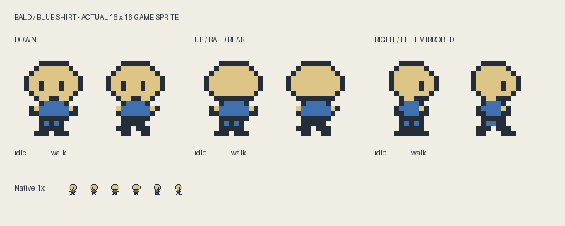
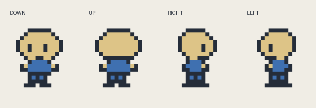

# Dungeon Journey

A native Game Boy Color game prototype made with GB Studio and the ModRetro Chromatic plugin.

## Playable today

Walk a small bald character in a blue shirt around one closed stone room. The character has genuine 16 × 16 idle and walking frames, four-direction movement, and solid wall collisions. Left-facing artwork mirrors the right-facing frames.

Use the D-pad on a Chromatic or Game Boy Color emulator. In the GB Studio browser export, use the arrow keys or the on-screen D-pad. This prototype has no combat, enemies, inventory, dialogue, or progression.

The built cartridge is in [`roms/dungeon-journey.gbc`](roms/dungeon-journey.gbc). It targets Game Boy Color hardware; a monochrome Game Boy is not supported by this build.





## Editable project

Open `project.gbsproj` in GB Studio 4.3.2. Native scenes, palettes and settings are under `project/`; game PNGs and their native sidecars are under `assets/`. The final player pixel rows and individual source frames are retained in `source-art/player/`.

The project uses only the standard top-down scene engine. There are no project-local engine extensions or plugin dependencies embedded in the game.

## Build

The validated compiler versions are GB Studio CLI 4.3.2 and GBDK 4.5.0, using Node 24.11.1. Install the official tools separately; no compiler or emulator binaries are included here.

With the ModRetro Chromatic plugin, select the absolute path to this repository's `project.gbsproj`, prepare the `build` component if needed, and use `rom_build` with `outputPath: "build/dungeon-journey.gbc"`. Use `web_preview` for the official browser export. Generated output is ignored by Git.

With a separately installed official GB Studio CLI:

```sh
gb-studio-cli make:rom project.gbsproj build/rom
gb-studio-cli make:web project.gbsproj build/web
```

CLI installations that expose a JavaScript entrypoint can invoke the same commands with `node /path/to/gb-studio-cli.js`. The CLI must have its compatible official toolchain configured. The included ROM is a copy of the verified build, not a substitute for building the editable project.

Optional player-art regeneration requires Python and Pillow:

```sh
python3 tools/author_player.py
```

This writes player PNGs and source previews. After changing pixels, update the sprite in GB Studio and rebuild the game; generating artwork alone does not update native sprite metadata or a ROM.

## Validation

The renamed project was compiled into a real GBC ROM and exercised in PyBoy 2.7.0. The renamed ROM booted correctly and runtime sprite positions confirmed blocking at all four walls. Recorded frames from the preceding build of the same artwork and movement verified four-direction animation, the bald rear-facing sprite, blue shirt and idle/walk poses. Those runtime observations showed two hardware sprite objects and no scanline overflow in the exercised room.

A previous build of the same walking-room gameplay was successfully streamed to a physical Chromatic for a 60-second host-emulated demo. Streaming does not write the cartridge and does not establish native cartridge performance. Save persistence and audio are not tested.

## Future direction

Dungeon Journey is the working game name. This commit establishes the character and movement-room prototype; the wider game design remains to be developed. No later gameplay systems are represented as implemented.

## Notices

No overall license for Dungeon Journey or its original game artwork is granted by this repository. The upstream GB Studio project-format metadata notice is retained separately in [`notices/GB-STUDIO-METADATA-LICENSE.txt`](notices/GB-STUDIO-METADATA-LICENSE.txt); it does not license the game's new artwork.

The included font and dialogue UI came from the ModRetro plugin's original starter. The room and final player artwork were authored for this prototype. Concept boards, third-party reference images, rejected drafts, local toolchains, captures, credentials and machine-specific configuration are not included.
